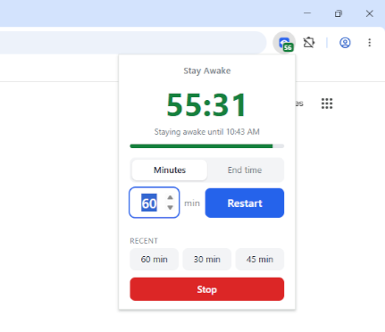

# Stay Awake

<p align="left">
  
</p>

A Chrome extension for ChromeOS that keeps a classroom Chromebook from dimming or locking for a chosen number of minutes or until a chosen clock time, up to 90 minutes. It does nothing until someone starts it.

Unlike a web page using the Screen Wake Lock API, the lock is held by the extension itself (`chrome.power.requestKeepAwake("display")`). It keeps working while other windows, fullscreen slides, video, or Android apps are in front.

## How teachers use it

- **Start by minutes:** click the eye icon in the toolbar, choose **Minutes**, type 1–90, and press **Start** or Enter.
- **Start by end time:** choose **End time** and pick a clock time. The popup shows the resulting run ("Runs 35 min, until 1:00 AM") before you start. The countdown ends exactly at that time, which must be 1–90 minutes away. A time earlier than now means tomorrow, so 12:20 AM picked at 11:50 PM works.
- **Recent:** each mode keeps its own one-click buttons, most recent first. Minutes mode shows the last 9 unique durations, and End time mode shows the last 9 unique end times. An end-time button is grayed out while that time is less than 1 or more than 90 minutes away.
- **Change or extend:** while it's running, enter a new duration or end time, or click a recent button, and press **Restart**. The countdown starts over; it doesn't add to the time left.
- **Stop:** the red **Stop** button.
- **Warning:** a notification appears 2 minutes before the end, with a **Restart** button for the same duration.
- **Status:** the toolbar badge shows minutes left. A blue open eye means active; a gray closed eye means off.

Nothing ever starts on its own. The countdown is cleared at sign-in and reboot. Recent durations, recent end times, and the last-used mode are kept.

## Settings in code

These constants are at the top of `background.js`:

- `MAX_MINUTES = 90` is the longest allowed duration or end-time distance. Also update `max="90"` in `popup.html`.
- `DEFAULT_MINUTES = 30` is pre-filled in the popup before any duration has been chosen.
- `WARN_MINUTES = 2` sets when the warning notification appears.
- `RECENT_COUNT = 9` sets how many recent durations and end times are remembered.

## Permissions

`power`, `alarms`, `storage`, `notifications`. The extension has no host permissions and reads no pages.

## Testing

1. Unzip the extension. Go to `chrome://extensions`, turn on Developer mode, and click **Load unpacked**.
2. Start a short run (1–3 minutes) to see the whole cycle quickly: start, badge countdown, warning (on runs over 2 minutes), and expiry.
3. On Windows, confirm the lock is held. Run `powercfg /requests` in an admin Command Prompt while it's running; Chrome should be listed under **DISPLAY:**. It should be gone after it stops.
4. On a Chromebook in the target OU, confirm it doesn't lock at the normal idle time.
5. With no input after expiry, time how long the device takes to lock. This shows whether ChromeOS counts idle time from the last input or restarts its idle clock when the lock is released.

## Deploying (Google Admin console)

Options:
- Publish **only to your domain** from a school publisher account.
- Publish from a personal account to the school's private store with an organization-publishing approval link.
- Publish **Unlisted**.
- Self-host.

Then:
1. In **Devices → Chrome → Apps & extensions → Users & browsers**, select the **teacher OU only**. Add the extension by ID and set it to **Force install + pin to browser toolbar**.
2. Check that screen wake locks (policy `AllowScreenWakeLocks`) are allowed for that OU.

## Limitation

Extensions can't lock a normal user session. When the timer ends, the extension releases its hold, and ChromeOS's own idle policy decides when to lock.

## Versioning

Releases are numbered as simple builds: Build 1, Build 2, and so on. For each new build, increase both fields in `manifest.json`:

```json
"version": "2",
"version_name": "Build 2"
```

Chrome uses `version` for updates, and the Web Store rejects an upload that isn't higher than the last one. `version_name` is the label shown on `chrome://extensions`. Tag GitHub releases to match, for example `build-2`.

## Credits

Developed by Mike Young ([@myoung8223](https://github.com/myoung8223)) using Anthropic Claude Opus 5.5 Medium.

## License

[MIT](LICENSE) © 2026 Mike Young
